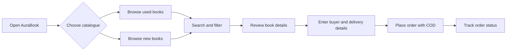
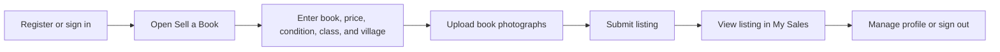
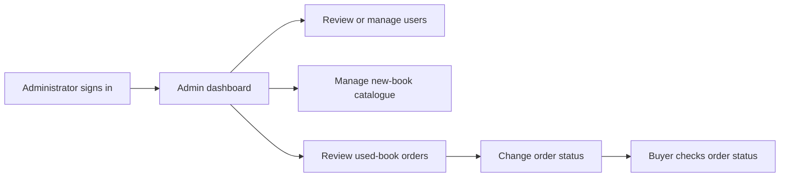
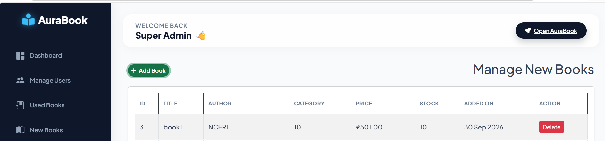
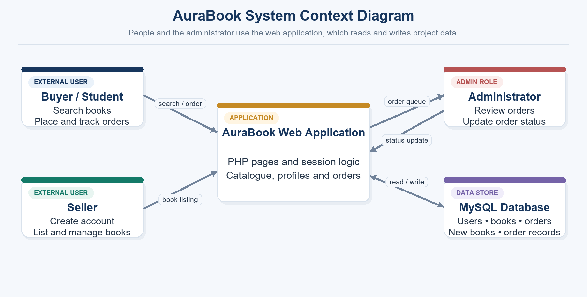
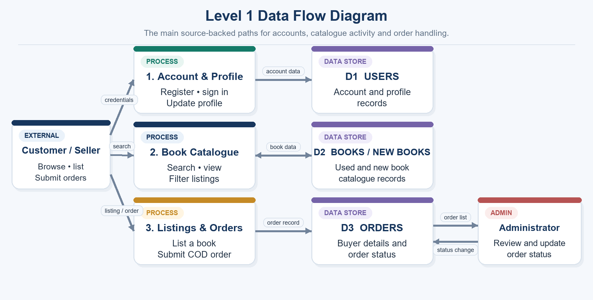
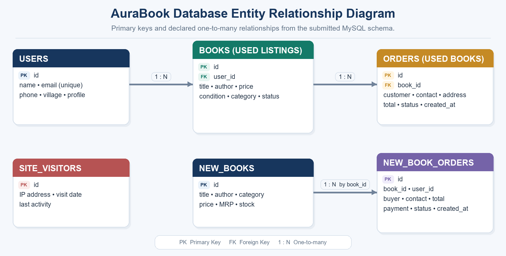
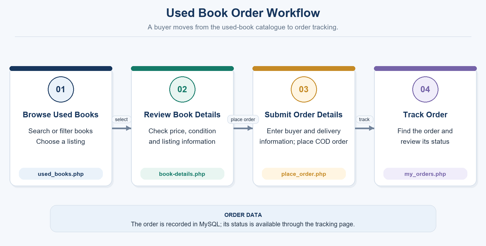
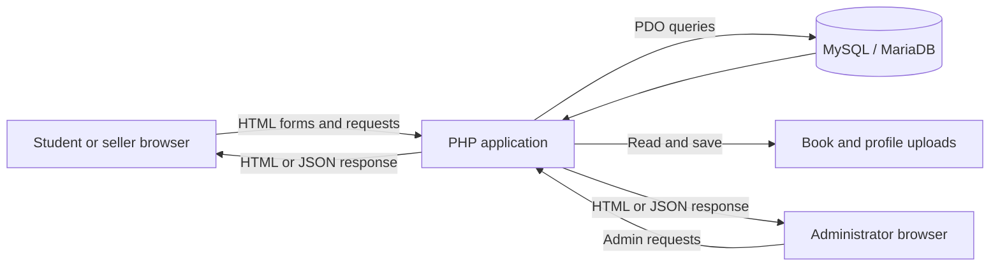

<p align="center">
  
</p>

<h1 align="center">📚 AuraBook</h1>

<p align="center">
  <strong>Smart Book Exchange and Learning Platform</strong><br>
  Affordable used and new books for students in rural and semi-urban communities.
</p>

<p align="center">
  
  
  
  
  
  
  
  
  
</p>

<p align="center">
  <a href="#-overview">Overview</a> ·
  <a href="#-features">Features</a> ·
  <a href="#-screenshots">Screenshots</a> ·
  <a href="#-getting-started">Getting Started</a> ·
  <a href="#-database">Database</a> ·
  <a href="#-security-and-privacy">Security</a>
</p>

---

## 📑 Table of Contents

- [Overview](#-overview)
- [Project Snapshot](#-project-snapshot)
- [Features](#-features)
- [User Workflows](#-user-workflows)
- [Screenshots](#-screenshots)
- [System Diagrams](#-system-diagrams)
- [Technology Stack](#-technology-stack)
- [Architecture](#-architecture)
- [Core Modules](#-core-modules)
- [Database](#-database)
- [Getting Started](#-getting-started)
- [Deployment Notes](#-deployment-notes)
- [Security and Privacy](#-security-and-privacy)
- [Academic Context](#-academic-context)
- [Roadmap Ideas](#-roadmap-ideas)
- [Contributing](#-contributing)
- [References](#-references)
- [License](#-license)

---

## 🌟 Overview

**AuraBook** is a web-based book marketplace and learning resource platform built for students in rural and semi-urban communities. It combines **used-book listings**, a **new-book catalogue**, **seller tools**, **buyer orders**, and an **administrator panel** in a single PHP + MySQL application.

Students can search for books, filter used listings by **village** and **category/class**, and use the interface in **Gujarati, Hindi, or English**. Sellers get a simple way to list books with condition, price, location, and photographs, so affordable books can be found close to home.

### Why AuraBook?

- 📍 **Local discovery**: find used books in nearby villages.
- 💸 **Affordable**: second-hand books at student-friendly prices.
- 🗣️ **Multilingual**: Gujarati, Hindi, and English interface text.
- 🚚 **Simple checkout**: Cash on Delivery, with no online payment gateway needed.

---

## 🧾 Project Snapshot

| Item | Details |
|---|---|
| **Product** | AuraBook — Smart Book Exchange and Learning Platform |
| **Audience** | Students, book sellers, and administrators |
| **Main use** | Discover nearby used books, browse new books, and place orders |
| **Backend** | PHP with MySQL / MariaDB |
| **Local environment** | WAMP Server, Apache, and phpMyAdmin |
| **Languages** | Gujarati, Hindi, and English |
| **Payment flow** | Cash on Delivery (COD) |
| **Academic context** | BCA Semester V, Subject 506 — Project Development |

---

## ✨ Features

### 🔍 Book Discovery

- Browse **used books** and **new books** in separate catalogues
- Search by **title**, **author**, or **subject**
- Filter used listings by **village** and **category / class**
- View listing details: author, condition, price, description, and images
- Explore learning categories: school classes, college and ITI, competitive exams, stories, and downloadable reading resources

### 👤 Student and Seller Accounts

- Register and sign in securely
- Recover account access via the account recovery form
- Create used-book listings with title, author, price, condition, village, category/class, description, and **up to 5 photographs**
- Review your listings in the **My Sales** area
- View and update profile details and profile photo

### 🛒 Orders

- Place **used-book** or **new-book** orders with buyer contact and delivery details
- Pay with **Cash on Delivery**
- Look up used-book order status with the contact information requested on the order page

### 🛠️ Administration

- Review users, new-book inventory, and used-book orders
- Add and manage the new-book catalogue
- Update order status from the admin interface
- Display site visit counts on the home page

---

## 🔄 User Workflows

### Buyer



### Seller



### Administrator



---

## 🖼️ Screenshots

<p align="center">
  
</p>
<p align="center"><em>Home page — book discovery, search, language choices, and catalogue shortcuts.</em></p>

<p align="center">
  
</p>
<p align="center"><em>Admin catalogue — add and review new-book inventory.</em></p>

---

## 🗺️ System Diagrams

| System Context | Level 1 Data Flow |
|:---:|:---:|
|  |  |

| Database ERD | Used-Book Order Workflow |
|:---:|:---:|
|  |  |

---

## 🧰 Technology Stack

| Layer | Technology |
|---|---|
| **Frontend** | HTML5, CSS3, JavaScript, Bootstrap 5, Font Awesome |
| **Backend** | PHP |
| **Database** | MySQL or MariaDB |
| **Data access** | PDO with prepared statements |
| **Authentication** | PHP sessions and bcrypt password hashing |
| **Local development** | WAMP Server or any Apache/PHP/MySQL environment |
| **DB administration** | phpMyAdmin or an equivalent MySQL client |

---

## 🏗️ Architecture

The browser loads PHP pages from the web server. PHP reads the session, validates requests, uses PDO to query MySQL, and returns HTML or JSON. Book and profile photographs are stored in upload directories, with relative image paths recorded in database rows.



---

## 🧩 Core Modules

| File / Module | Role |
|---|---|
| `index.php` | Home page, navigation, learning shortcuts, and visitor count |
| `auth.php` | Registration, sign-in, and account recovery |
| `used_books.php` · `book-details.php` | Used-book directory, filters, and listing details |
| `sell.php` · `my_sales.php` | Create a used-book listing and review a seller's listings |
| `new_books.php` · `buy_new_book.php` | New-book catalogue, availability, and order details |
| `place_order.php` · `my_orders.php` | Save used-book orders and look up order status |
| `profile.php` | Profile information and profile photo |
| `admin_order.php` | Administrator order review and status updates |
| `db.php` | Database connection settings |
| `kitabbazar.sql` | MySQL database schema |

---

## 🗄️ Database

AuraBook uses **six relational tables** (database name: `kitabbazar`):

| Table | Purpose |
|---|---|
| `users` | Student account, contact, village, and profile information |
| `books` | Used-book listings and seller details |
| `new_books` | New-book catalogue, price, MRP, and stock |
| `orders` | Buyer and delivery records for used-book orders |
| `new_book_orders` | Buyer and payment/status records for new-book orders |
| `site_visitors` | Visit date, recent activity, and IP-based visitor count data |

**Relationships:** a user can have multiple book listings; used-book orders refer to a listed book; new-book orders refer to a new-book record. The schema uses primary keys, foreign keys, and a unique email constraint for accounts.

---

## 🚀 Getting Started

### Prerequisites

- Apache + PHP + MySQL/MariaDB (for example, **WAMP Server**)
- PHP with the **PDO MySQL** driver and **file uploads** enabled
- A modern web browser

### Installation

1. **Clone the repository**

   ```bash
   git clone https://github.com/<your-username>/AuraBook.git
   ```

2. **Copy the project** into your server document root, for example:

   ```
   C:\wamp64\www\AuraBook
   ```

3. **Start Apache and MySQL** from the WAMP control panel.

4. **Import the database**
   - Open phpMyAdmin
   - Create or select a database named `kitabbazar`
   - Import `kitabbazar.sql`

5. **Configure the connection** in `db.php` (host, database name, username, password).
   > ⚠️ Never commit real credentials to a public repository.

6. **Prepare upload folders** — make sure the book and profile upload folders exist and are writable by the web server.

7. **Run the app**

   ```
   http://localhost/AuraBook/index.php
   ```

> The folder name may differ in your copy of the project. Keep the PHP pages, SQL file, and upload folders together, and use your folder name in the local URL.

---

## ☁️ Deployment Notes

- Checkout uses **Cash on Delivery**. No third-party payment gateway is included.
- **GitHub Pages cannot run PHP.** Keep the source code on GitHub, and use a PHP/MySQL-capable host for a fully working deployment. See the [GitHub Pages documentation](https://docs.github.com/en/pages/getting-started-with-github-pages/creating-a-github-pages-site).

---

## 🔐 Security and Privacy

- Passwords are hashed with **bcrypt**; database access uses **PDO prepared statements**.
- Keep database passwords, real user records, and personal upload files **out of public repositories** (consider a `.gitignore` for config and upload folders).
- The database stores **IP addresses** for visitor-count activity. Review data-retention and privacy needs before deploying publicly.
- Use **test accounts and sample listings** for demos. Do not expose students' phone numbers, emails, or profile photographs.

---

## 🎓 Academic Context

AuraBook is a **Semester V** project for **Subject 506 — Project Development** at **Smt. B.K. Mehta I.T. Centre (BCA College), Palanpur**. It focuses on improving access to affordable books for students in nearby villages.

---

## 🛣️ Roadmap Ideas

Possible future improvements (not part of the current release):

- [ ] Online payment gateway option alongside COD
- [ ] Email/SMS notifications for order status changes
- [ ] Wishlist and book request feature
- [ ] Ratings and seller verification
- [ ] Admin analytics dashboard
- [ ] Deployment on a PHP/MySQL hosting provider

---

## 🤝 Contributing

Suggestions and improvements are welcome.

1. Fork the repository
2. Create a feature branch: `git checkout -b feature/your-feature`
3. Commit your changes: `git commit -m "Add your feature"`
4. Push the branch: `git push origin feature/your-feature`
5. Open a Pull Request

---

## 📚 References

- [PHP Documentation](https://www.php.net/docs.php)
- [MySQL Reference Manual](https://dev.mysql.com/doc/)
- [Bootstrap 5](https://getbootstrap.com/)
- [Font Awesome](https://fontawesome.com/)
- [GitHub Pages Documentation](https://docs.github.com/en/pages/)

---

## 📄 License

No open-source license is specified for this project. Obtain the project owners' permission before reusing or redistributing the source code, database content, or images.

---

<p align="center">
  Made with ❤️ for students · <strong>AuraBook</strong>
</p>
