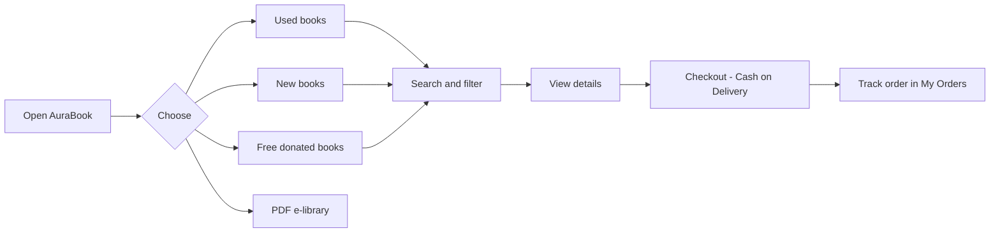
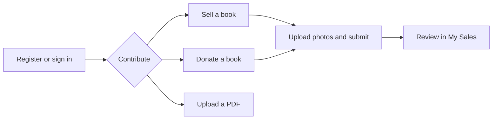
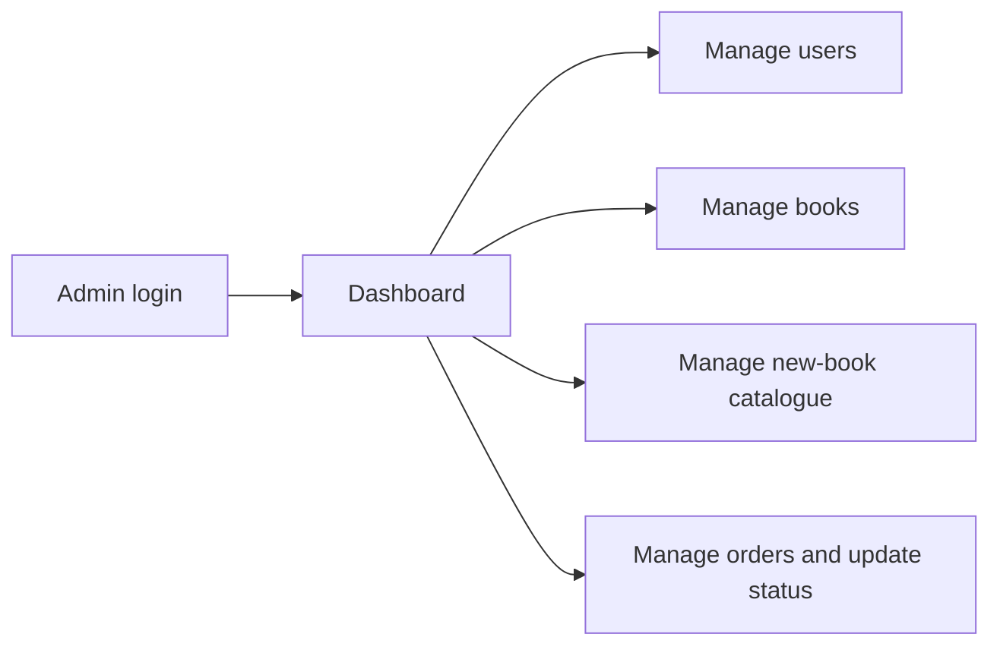
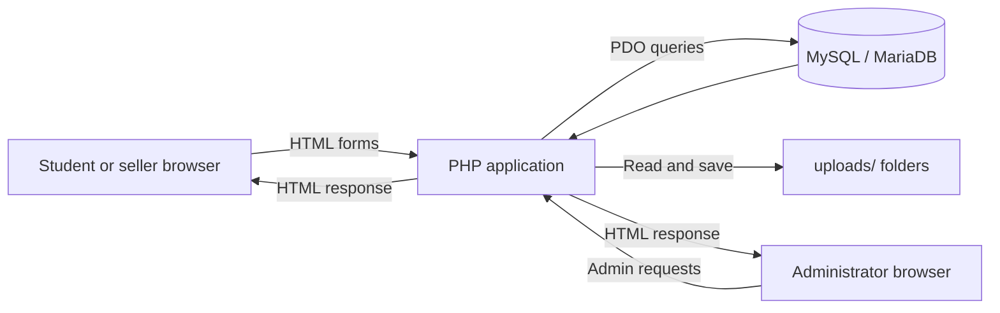

<p align="center">
  
</p>

<h1 align="center">📚 AuraBook</h1>

<p align="center">
  <strong>Smart Book Exchange and Learning Platform</strong><br>
  Affordable used books, new books, free book donations and a free PDF e-library for students in rural and semi-urban communities.
</p>

<p align="center">
  
  
  
  
  
  
  
  
  
</p>

---

## 📑 Table of Contents

- [Overview](#-overview)
- [Features](#-features)
- [User Workflows](#-user-workflows)
- [Screenshots](#-screenshots)
- [Technology Stack](#-technology-stack)
- [Architecture](#-architecture)
- [Project Structure](#-project-structure)
- [Database](#-database)
- [Getting Started](#-getting-started)
- [Admin Panel](#-admin-panel)
- [Security and Privacy](#-security-and-privacy)
- [Deployment Notes](#-deployment-notes)
- [Academic Context](#-academic-context)
- [Developers](#-developers)
- [License](#-license)

---

## 🌟 Overview

**AuraBook** is a web-based book marketplace and learning platform for students in rural and semi-urban communities. It brings **used-book listings**, a **new-book catalogue**, **free book donations**, a **PDF e-library**, **buyer orders** and an **administrator panel** together in one PHP + MySQL application.

Students can search books, filter listings by village and category, and switch the interface between **Gujarati** and **English**. Sellers and donors can list books with condition, price, location and photographs, so affordable books can be found close to home.

| Item | Details |
|---|---|
| **Audience** | Students, book sellers/donors, administrators |
| **Backend** | PHP with MySQL / MariaDB (PDO) |
| **Local environment** | WAMP Server, Apache, phpMyAdmin |
| **Interface language** | Gujarati and English toggle |
| **Payment** | Cash on Delivery (COD) |
| **Academic context** | BCA Semester V, Subject 506 — Project Development |

---

## ✨ Features

### 🔍 Book Discovery
- Separate catalogues for **used books** and **new books**
- **Browse & Get Old Books** page for donated/free books
- Search by title, author or subject; filter by village and category/class
- Detail pages with condition, price, description and photographs
- Learning shortcuts: school classes, college/ITI, competitive exams, general reading

### 📄 PDF E-Library
- Browse **free digital PDF books** with search and category filter
- Logged-in users can upload a PDF with title, author, category, description and an optional cover image

### 👤 Accounts, Selling and Donating
- Register, sign in and sign out
- **Sell a Book** with title, author, price, condition, village, category/class, description and multiple photos
- **Donate / Sell Old Books** form (free donation or priced listing, with contact number and location)
- **My Sales** to review your listings, **My Orders** to track orders
- Profile page with profile photo

### 🛒 Orders
- Order used or new books with buyer contact and delivery details
- **Checkout** shows the book price plus delivery/platform fee, paid by **Cash on Delivery**
- Order status lookup for buyers

### 🛠️ Administration
- Separate **Admin Panel** with login, dashboard counts and management pages
- Manage users, used books, new-book catalogue, used-book orders and new-book orders
- Update order status
- Home page shows a **site visitor counter**

---

## 🔄 User Workflows







---

## 🖼️ Screenshots

<p align="center">
  
</p>
<p align="center"><em>Home page — discovery, search, language toggle and catalogue shortcuts.</em></p>

<p align="center">
  
</p>
<p align="center"><em>Admin — add and review new-book inventory.</em></p>

| System Context | Level 1 Data Flow |
|:---:|:---:|
|  |  |

| Database ERD | Used-Book Order Workflow |
|:---:|:---:|
|  |  |

---

## 🧰 Technology Stack

| Layer | Technology |
|---|---|
| Frontend | HTML5, CSS3, JavaScript, Bootstrap 5, Font Awesome |
| Backend | PHP |
| Database | MySQL / MariaDB |
| Data access | PDO with prepared statements |
| Authentication | PHP sessions, `password_hash()` / `password_verify()` |
| Local development | WAMP Server (or any Apache + PHP + MySQL stack) |

---

## 🏗️ Architecture



Image and PDF files are stored in upload folders; only their relative paths are stored in the database.

---

## 📁 Project Structure

```text
AuraBook/
├── index.php              # Home page, language toggle, visitor counter
├── register.php · login.php · logout.php · auth.php
├── used_books.php · book-details.php        # Used-book catalogue and details
├── new_books.php · newbook-details.php      # New-book catalogue and details
├── buy_new_book.php · checkout.php          # New-book order and checkout
├── sell.php · my_sales.php                  # Create and review listings
├── donate_book.php · browse_books.php       # Free donation and browsing
├── pdf_library.php                          # PDF e-library
├── place_order.php · my_orders.php          # Orders and status lookup
├── profile.php                              # Profile and profile photo
├── admin_order.php · admin_setup.php        # Admin helpers / one-time admin setup
├── admin/                                   # Admin panel
│   ├── login.php · logout.php · register.php
│   ├── index.php (dashboard) · header.php · footer.php
│   └── manage_users / books / new_books / orders / new_book_orders .php
├── db.php                                   # Database connection
├── kitabbazar.sql                           # Database schema
└── uploads/                                 # books, newbook, oldbook, pdfs, pdf_covers, profiles
```

---

## 🗄️ Database

Database name: **`kitabbazar`**

| Table | Purpose |
|---|---|
| `users` | Student accounts, contact, village, profile photo |
| `books` | Used-book listings and seller details |
| `new_books` | New-book catalogue: price, MRP, stock |
| `orders` | Used-book orders |
| `new_book_orders` | New-book orders with payment/status |
| `site_visitors` | Visit date and IP-based visitor count |
| `admins` | Administrator accounts (created by the admin setup) |
| `pdf_books` | PDF e-library entries |
| `donated_books` | Donated / free book listings |

**Relationships:** a user has many book listings; used-book orders reference a book; new-book orders reference a new book (all with `ON DELETE CASCADE`). Account emails are unique.

> ⚠️ **Note:** `kitabbazar.sql` currently contains the first six tables. The `admins` table is created automatically by the admin setup, while `pdf_books` and `donated_books` must be added to the SQL file (or created manually) for the PDF library and donation pages to work on a fresh install.

---

## 🚀 Getting Started

### Prerequisites
- Apache + PHP + MySQL/MariaDB (e.g. **WAMP Server**)
- PHP with **PDO MySQL** and **file uploads** enabled

### Installation

1. **Clone the repository**
   ```bash
   git clone https://github.com/<your-username>/AuraBook.git
   ```
2. **Copy** the project into your server root, e.g. `C:\wamp64\www\AuraBook`.
3. **Start** Apache and MySQL from the WAMP control panel.
4. **Import the database:** in phpMyAdmin create `kitabbazar` and import `kitabbazar.sql`.
5. **Configure** `db.php` with your host, database, username and password.
   > Never commit real credentials to a public repository.
6. **Create the admin account** by opening `http://localhost/AuraBook/admin_setup.php` once, then change the default password immediately.
7. **Check upload folders** under `uploads/` exist and are writable.
8. **Open** `http://localhost/AuraBook/index.php`.

---

## 🛠️ Admin Panel

Open `http://localhost/AuraBook/admin/login.php`. From the dashboard, administrators can manage users, used books, the new-book catalogue and both order types, and update order status.

---

## 🔐 Security and Privacy

- Passwords are hashed and queries use PDO prepared statements.
- **Before any public deployment:**
  - Change the default admin credentials and remove or protect `admin_setup.php`
  - Use a dedicated database user instead of `root`
  - Disable debugging/error display
- Do not commit `db.php` secrets, real user data or personal uploads (profile photos). Use the provided `.gitignore`.
- Visitor tracking stores **IP addresses**; review data-retention and privacy needs before going public.
- Use test accounts and sample listings in demos.

---

## ☁️ Deployment Notes

- Checkout uses **Cash on Delivery**; no payment gateway is included.
- **GitHub Pages cannot run PHP.** Keep the code on GitHub and host the working app on a PHP/MySQL-capable service.

---

## 🎓 Academic Context

Semester V project for **Subject 506 — Project Development** at **Smt. B.K. Mehta I.T. Centre (BCA College), Palanpur**, aimed at improving access to affordable books for students in nearby villages.

---

## 👨‍💻 Developers

| | Name |
|:---:|---|
|  | **Dhruv** |
|  | **Marvan** |

---

## 📄 License

No open-source license is specified. Obtain the project owners' permission before reusing or redistributing the source code, database content or images.

---

<p align="center">Made with ❤️ for students · <strong>AuraBook</strong></p>
