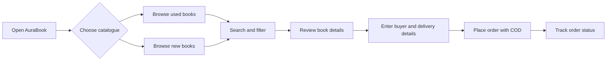
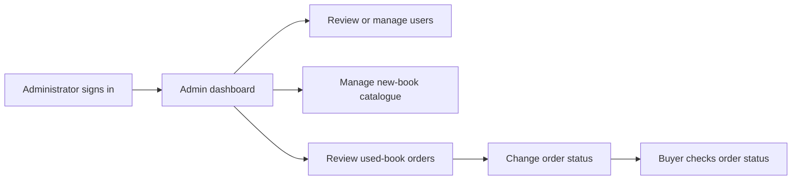

# AuraBook
AuraBook - Smart Book Exchange and Learning Platform
<div align="center">
  
  <h1>AuraBook</h1>
  <p><strong>Smart Book Exchange and Learning Platform</strong></p>
  <p>Find, buy, sell, and exchange books with students in nearby villages.</p>
</div>

<p align="center">
  
  
  
  
  
  
</p>

## Overview

AuraBook is a web-based book marketplace and learning resource platform for students in rural and semi-urban communities. It brings used-book listings, a new-book catalogue, seller listings, buyer orders, and administrator tools into one PHP and MySQL application. The interface includes book search, village and category filters, and Gujarati and English language options described in the supplied project report.

The project is designed to help students discover affordable books nearby and give sellers a simple way to list books with condition, price, location, and photographs.

## Features

### Book discovery

- Browse used books and new books in separate catalogues
- Search by book title, author, or subject
- Filter used-book listings by village and category or class
- Review listing details such as author, condition, price, description, and images
- Explore learning-oriented categories, including school classes, college and ITI, competitive exams, stories, and downloadable reading resources

### Student and seller accounts

- Register and sign in with an account
- Recover account access using the account recovery form
- Create used-book listings with title, author, price, condition, village, category or class, description, and up to five photographs
- Review personal listings in the My Sales area
- View and update profile details and profile photo

### Orders and administration

- Submit used-book or new-book orders with buyer contact and delivery details
- Use Cash on Delivery as the displayed payment method
- Find used-book orders using the contact information requested by the order page
- Let administrators review users, new-book inventory, and used-book orders
- Update order status from the administration interface
- Display site visit counts on the home page

## How the workflows fit together

### Buyer workflow



### Seller workflow


### Administrator workflow



## Screenshots and system diagrams

### Main interface and administration

<p align="center">
  
</p>
<p align="center"><em>Home page — book discovery, search, language choices, and catalogue shortcuts.</em></p>

<p align="center">
  
</p>
<p align="center"><em>Admin catalogue — add and review new-book inventory.</em></p>

### Application diagrams

| System context | Level 1 data flow |
|---|---|
|  |  |

| Database entity relationships | Used-book order workflow |
|---|---|
|  |  |

## Technology stack

| Layer | Technology |
|---|---|
| Frontend | HTML5, CSS3, JavaScript, Bootstrap 5, Font Awesome |
| Backend | PHP |
| Database | MySQL or MariaDB |
| Data access | PDO and prepared statements |
| Authentication | PHP sessions and bcrypt password hashing |
| Local development | WAMP Server or another Apache/PHP/MySQL environment |
| Database administration | phpMyAdmin or an equivalent MySQL client |

## Application architecture

The browser loads PHP pages from the web server. PHP reads the session, validates requests, uses PDO to query MySQL, and returns HTML or JSON. Book and profile photographs are stored in upload directories, with relative image paths recorded in database rows.

```text
Browser
  ├── HTML, CSS, JavaScript, Bootstrap
  └── PHP pages and form handlers
        ├── PHP sessions for signed-in users
        ├── PDO prepared queries
        ├── Image upload folders
        └── MySQL database: kitabbazar
```

## Core application modules

| File or module | Role |
|---|---|
| `index.php` | Home page, navigation, learning shortcuts, and visitor count |
| `auth.php` | Registration, sign-in, and account recovery handling |
| `used_books.php` and `book-details.php` | Used-book directory, filters, and listing details |
| `sell.php` and `my_sales.php` | Create a used-book listing and review a seller's listings |
| `new_books.php` and `buy_new_book.php` | New-book catalogue, availability, and order details |
| `place_order.php` and `my_orders.php` | Save used-book orders and look up order status |
| `profile.php` | Signed-in profile information and profile photo |
| `admin_order.php` | Administrator order review and status updates |
| `kitabbazar.sql` | MySQL database schema and initial database content |

## Database overview

The supplied project report describes these six database tables:

| Table | Purpose |
|---|---|
| `users` | Student account, contact, village, and profile information |
| `books` | Used-book listings and seller details |
| `new_books` | New-book catalogue, price, MRP, and stock |
| `orders` | Buyer and delivery records for used-book orders |
| `new_book_orders` | Buyer and payment/status records for new-book orders |
| `site_visitors` | Visit date, recent activity, and IP-based visitor count data |

Declared relationships include a user having multiple book listings, used-book orders referring to a listed book, and new-book orders referring to a new-book record. The SQL dump uses primary keys, foreign keys, and a unique email constraint for accounts.

## Run locally

1. Install a local server package with Apache, PHP, and MySQL or MariaDB, such as WAMP Server.
2. Copy the AuraBook project folder into the server document root, commonly `C:\\wamp64\\www\\AuraBook`.
3. Start Apache and MySQL from the server control panel.
4. In phpMyAdmin, create or select the database named `kitabbazar` and import `kitabbazar.sql`.
5. Open `db.php` and set the local database host, database name, username, and password. Do not commit real credentials.
6. Confirm PHP has the PDO MySQL driver and file uploads enabled.
7. Ensure the book and profile upload folders exist and are writable by the local web server.
8. Open `http://localhost/AuraBook/index.php` in a browser and navigate through the main pages.

The exact PHP folder name may vary in the extracted project archive. Keep the PHP pages, SQL file, and upload folders together, and use that folder name in the local URL.

## Important project notes

- The checkout flow described in the project uses Cash on Delivery. No third-party online payment gateway is included.
- GitHub Pages cannot execute PHP. Keep the source code on GitHub, and use a PHP/MySQL-capable host for a fully working deployment. See [GitHub Pages documentation](https://docs.github.com/en/pages/getting-started-with-github-pages/creating-a-github-pages-site).
- Keep database passwords, real user records, and personal upload files out of public repositories.
- The database tracks IP addresses for visitor-count activity; review data-retention and privacy needs before deploying publicly.
- Use test accounts and sample book listings in demonstrations. Do not expose students' phone numbers, emails, or profile photographs.

## Academic context

AuraBook is documented as a Semester V project for Subject 506 — Project Development at Smt. B.K. Mehta I.T. Centre (BCA College), Palanpur. The project materials refer to affordable access to books for students in nearby villages.

## References

- [PHP documentation](https://www.php.net/docs.php)
- [MySQL reference manual](https://dev.mysql.com/doc/)
- [Bootstrap 5](https://getbootstrap.com/)
- [Font Awesome](https://fontawesome.com/)
- [GitHub Pages documentation](https://docs.github.com/en/pages/)

## License

No open-source license is specified in the supplied project materials. Obtain the project owners' permission before reusing or redistributing the source code, database content, or images.
